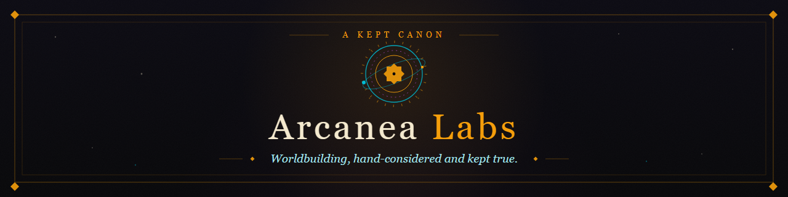

Creative worldbuilding platform, character and story studio, and open agent extensions.

Arcanea is a canon-locked creative universe plus the software that produces it: a world graph that keeps
characters and places consistent, a studio that renders scenes from that graph, an orchestrator that runs
the creative agents, and skill packs that check generated work against canon before anyone publishes it.

**Website** [arcanea.ai](https://www.arcanea.ai) · **Sister orgs** [Starlight Intelligence](https://github.com/Starlight-Intelligence) · [Starlight Systems](https://github.com/Starlight-Intelligence-Systems) · [GenCreator](https://github.com/GenCreator-ai) · [FrankX](https://github.com/FrankX-AI)

---

## Repositories

| Repository | What it does |
| :--- | :--- |
| [**Arcanea**](https://github.com/Arcanea-Labs/Arcanea) | Core creative framework: the Ten Gates progression, Guardian companions, and canon-locked worldbuilding. |
| [**arcanea-ai-app**](https://github.com/Arcanea-Labs/arcanea-ai-app) | The web application: world creation, interactive reading, and character companions. |
| [**arcanea-studio**](https://github.com/Arcanea-Labs/arcanea-studio) | Generative media studio: image, video, lipsync, and cinematic model routing in one surface. |
| [**arcanea-orchestrator**](https://github.com/Arcanea-Labs/arcanea-orchestrator) | Multi-agent orchestrator tuned for creative writing, lore verification, and visual production. |
| [**arcanea-onchain**](https://github.com/Arcanea-Labs/arcanea-onchain) | Provenance and collections: artifact attestation and contract scaffolding for creative worlds. |
| [**arcanea-ecosystem**](https://github.com/Arcanea-Labs/arcanea-ecosystem) | Architecture index and coordination across the Arcanea repositories. |

## Start here

```bash
# The web application (pnpm 11)
git clone https://github.com/Arcanea-Labs/arcanea-ai-app.git
cd arcanea-ai-app && pnpm install && pnpm dev

# The substrate CLI (Starlight Intelligence System)
npm install @arcanea/starlight-intelligence-system
```

## Canon discipline

A creative universe only compounds if it does not contradict itself. Canon lives in the repository that
produces it and changes by ratification, not by generation. Creative agents propose; a review step checks
names, world law, and continuity; only then does the change land. Generated work that fails the check is
regenerated rather than shipped.

## Rights

Arcanea worlds, characters, canon, artwork, and written material are rights reserved. Public access grants
no content, adaptation, merchandising, or model-training license. Code carries its own license where a
`LICENSE` file states one, and third-party material keeps its original terms and attribution.

See [LICENSING.md](https://github.com/Arcanea-Labs/.github/blob/main/LICENSING.md) for the full position.

---

<sub>Maintained by <a href="https://github.com/frankxai">Frank Riemer</a> · Built on the <a href="https://github.com/Starlight-Intelligence-Systems/Starlight-Intelligence-System">Starlight Intelligence Protocol</a></sub>
