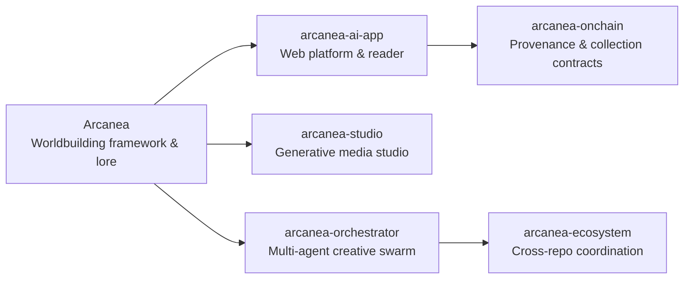

# Arcanea Labs

Creative worldbuilding platform, character and story studio, and open agent extensions.

**Website:** [arcanea.ai](https://arcanea.ai) · **Ecosystem:** [Starlight Intelligence](https://github.com/Starlight-Intelligence) · [Starlight Systems](https://github.com/Starlight-Intelligence-Systems) · [Arcanea Labs](https://github.com/Arcanea-Labs) · [GenCreator](https://github.com/GenCreator-ai) · [FrankX](https://github.com/FrankX-AI)

---

## Overview

Arcanea Labs builds open creative intelligence infrastructure: persistent world graphs, canon-verified narrative systems, generative media studios, and multi-agent orchestrators for authors and worldbuilders.

## System topology



## Flagship repositories

| Repository | Purpose | Link |
| :--- | :--- | :--- |
| [**Arcanea**](https://github.com/Arcanea-Labs/Arcanea) | Core creative framework: Ten Gates progression, Guardian companions, and canon-locked worldbuilding. | [Website](https://arcanea.ai) |
| [**arcanea-ai-app**](https://github.com/Arcanea-Labs/arcanea-ai-app) | Production web application for world creation, interactive reading, and character companions. | [Website](https://arcanea.ai) |
| [**arcanea-studio**](https://github.com/Arcanea-Labs/arcanea-studio) | Provider-agnostic generative media studio for visual scenes, audio, and storyboards. | [Website](https://arcanea.ai) |
| [**arcanea-orchestrator**](https://github.com/Arcanea-Labs/arcanea-orchestrator) | Multi-agent orchestrator tuned for creative writing, lore verification, and visual production. | [Website](https://arcanea.ai) |
| [**arcanea-onchain**](https://github.com/Arcanea-Labs/arcanea-onchain) | On-chain provenance, artifact attestation, and collection contracts for creative worlds. | [Website](https://arcanea.ai) |
| [**arcanea-ecosystem**](https://github.com/Arcanea-Labs/arcanea-ecosystem) | Architecture index and cross-repository coordination across the Arcanea constellation. | [Website](https://arcanea.ai) |

## Quickstart

```bash
# Clone the Arcanea core framework
git clone https://github.com/Arcanea-Labs/Arcanea.git

# Run the Arcanea web application locally
git clone https://github.com/Arcanea-Labs/arcanea-ai-app.git
cd arcanea-ai-app && pnpm install && pnpm dev
```

## Engineering standards

Every repository in **Arcanea Labs** follows the Starlight estate engineering contract:

1. **Draft-first pull requests**: Open pull requests in draft mode (`gh pr create --draft`). CI workflows run only when a pull request is marked ready for review or lands on `main`.
2. **Independent verification**: Maker harness and Checker harness must differ (`Maker-Harness` != `Checker-Harness`).
3. **Zero committed secrets**: Credentials live in local environment files or Infisical. Pre-commit and CI gates reject secret patterns.
4. **Editorial clarity**: Public documentation uses sentence case headings, concrete verbs, and verified metrics.

---

<sub>Maintained by <a href="https://github.com/frankxai">Frank Riemer (frankxai)</a> · Built on the <a href="https://github.com/Starlight-Intelligence-Systems/Starlight-Intelligence-System">Starlight Intelligence Protocol (SIP)</a></sub>
